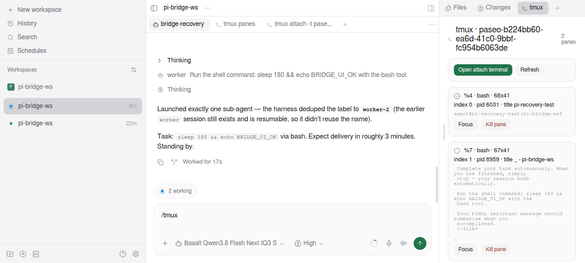
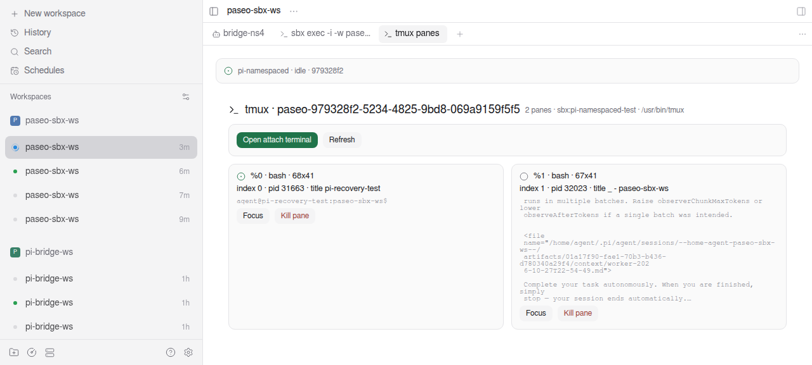
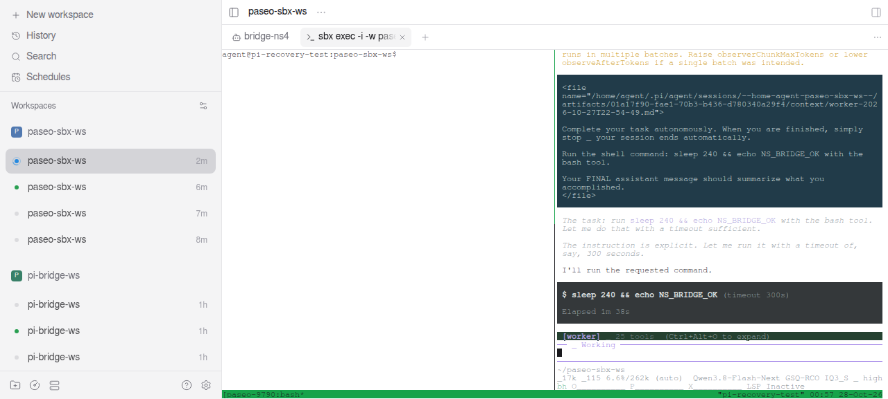
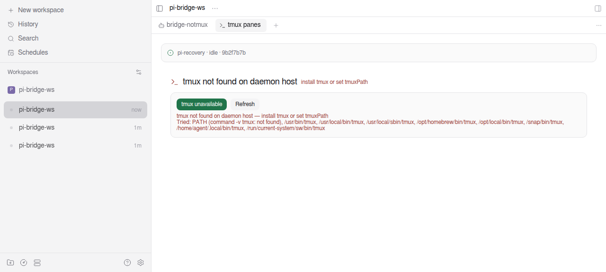

# pi-tmux-bridge

A Paseo plugin that makes tmux-based Pi extensions behave inside Paseo the way they do inside tmux.
Built for [`amosblomqvist/pi-interactive-subagents`](https://github.com/amosblomqvist/pi-interactive-subagents)
(the "Amos" interactive subagents extension), which spawns subagents into tmux panes.

## What it looks like

The panel, docked beside the agent chat, showing two panes side by side with live screen captures:



The same view for a **sandboxed** provider — the session lives inside the container, and the panel
says so (`sbx:pi-namespaced-test · /usr/bin/tmux`):



The auto-opened attach terminal, rendering the namespace's tmux window: host shell on the left, the
subagent's live Pi TUI on the right:



And when tmux cannot be found, the panel states it instead of staying blank:



## The problem

Paseo launches Pi as a **stdio RPC child, not inside a PTY**, so a Pi agent has no tmux
environment. Amos gates every pane operation on `!!process.env.TMUX && tmux on PATH` and always
splits off `process.env.TMUX_PANE`. Two consequences follow:

- If the Paseo daemon was **not** started inside tmux, `TMUX` is absent and Amos refuses with
  `tmux is required for subagents`.
- If the daemon **was** started inside tmux, every Pi agent inherits the *same* `TMUX`/`TMUX_PANE`
  (the pane the daemon happened to be in). All agents then split from one shared — often dead —
  pane, so panes collide, land in the wrong window, or `split-window -t %N` fails outright.

## What this plugin does

On `agent.session_open` for an interactive **Pi** session:

- `purpose` must be `"interactive"` (`history` / `import` sessions are left alone).
- The provider must be Pi. Paseo reports a custom provider's **own** id, never `"pi"`: a provider
  declared as `extends: "pi"` (for example `pi-recovery`) arrives as `provider: "pi-recovery"`.
  Any provider id containing a `pi` token (`pi`, `pi-recovery`, `local_pi`, `my.pi`) is matched, and
  `piProviders` lets you list exact ids. `pilot` and `openapi` do not match.

1. Creates (or reuses) a private tmux session named `<sessionPrefix><agentId>` — default prefix
   `paseo-` — **in the namespace the agent runs in** (the daemon host, or wherever `tmuxExec` /
   `providerTmuxExec` points), with a long-lived placeholder pane (`$SHELL -l`, falling back to
   `tail -f /dev/null`). A dead host pane would kill Amos's split target, so it must stay alive.
2. Applies the layout (default `even-horizontal`, matching Amos's own constant) and reads that
   session's `pane_id` plus the tmux `socket_path`.
3. Injects into the launch env — always spreading the existing env, because Paseo does **not**
   deep-merge `env`:

   | variable | value |
   | --- | --- |
   | `TMUX` | `<socket_path>,<tmux server pid inside the namespace>,0` |
   | `TMUX_PANE` | the placeholder pane id |
   | `PASEO_TMUX_SESSION` | the session name |
   | `PI_SUBAGENT_SHELL_READY_DELAY_MS` | `2000` (Amos's own default is `500`) |

4. Opens a Paseo terminal in the agent's workspace running `<prefix> tmux attach -t <session>` (the
   same prefix as every other tmux call), so the
   subagent panes appear side by side. Creation is fire-and-forget; it never blocks or fails launch.
   Amos identity variables (`PI_SUBAGENT_*`) inherited from the daemon are stripped from the launch
   env by default (`stripAmosIdentity`), otherwise Amos treats the agent as an existing subagent and
   refuses to spawn one.
5. On `agent.closed` / `agent.archived`, kills the attach terminal and — only when the session name
   is exactly this plugin's prefix plus this agent's id — kills the tmux session.

Because the hook re-runs on `create`, `resume`, `refresh` and `import`, the env is correct after a
daemon restart too (this sidesteps the documented caveat that creation-time env is not persisted).

**Fail-soft.** If tmux is missing or the session cannot be created, the plugin logs to stdout and
sets `TMUX=""`. An empty string is falsy in JS, so Amos reports its own clear error instead of
splitting a stale inherited pane. No code path in a lifecycle hook is allowed to throw.

## Install

Against your real Paseo:

```bash
paseo plugin install /path/to/pi-tmux-bridge
paseo daemon config set pluginsEnabled true      # plugins are globally disabled by default
paseo daemon restart                             # config reload alone is not enough for plugins
paseo plugin ls                                  # expect STATUS = running
```

There is no plugin watch mode; the dev loop is `paseo plugin reload pi-tmux-bridge`.

Requirements: `tmux` on the **daemon host**'s PATH (verified with tmux 3.6), Paseo >= 0.13.0.

## Use — how to actually see it

Paseo's tab launcher only lists **workspace**-context panels, so the plugin registers the view twice
and adds three ways in:

| entry point | where the view lands |
| --- | --- |
| `/tmux` in the agent composer | a **full-size workspace tab** |
| `/tmux-side` in the agent composer | the **explorer pane**, docked beside the agent chat |
| `+` (new tab) → **tmux panes** | a workspace tab; picks the agent for you |
| Command Center (`Search`) → **Open tmux panes for this agent** | full-size workspace tab |
| Command Center → **Dock tmux panes beside this agent's chat** | the explorer pane |
| Command Center → **Open tmux panes (any agent in this workspace)** | workspace tab, needs no agent in context |
| Command Center → **Open attach terminal for this agent** | a `tmux attach -t <session>` terminal tab |
| Command Center → **Configure Pi tmux bridge** | the settings screen |

`/tmux` opens the full-size tab because the explorer pane is narrow: the same view renders far better
as a tab. Docking is still there when you want the panes literally beside the session — the panel
polls every 2s, and with the default `even-horizontal` layout a subagent tmux splits to the right
shows up on the right, side by side with the main pane. Paseo persists the explorer pane per
workspace, so after docking it once it is there again on the next visit.

Two Paseo behaviours worth knowing, because both look like the plugin being broken:

- **Ctrl+K does nothing while a terminal has focus.** `packages/app/src/keyboard/keyboard-shortcuts.ts`
  registers the non-mac binding with `when: { mac: false, terminal: false }`. Click out of the terminal,
  or just use `/tmux` — the composer needs no shortcut.
- **Agent-context Command Center items are hidden unless a workspace *and* an agent are current**
  (`packages/app/src/plugins/command-center/contributions.ts`: `if (item.context === "agent" &&
  (!source.workspaceId || !source.agentId)) continue;`). That is why the workspace-level item exists.

The panel shows the session name, pane count, and per pane: id, index, `pane_current_command`, pid,
title, size, and the last N captured screen lines **in colour** — tmux is captured with `capture-pane
-e`, non-SGR sequences are stripped server-side, and the runs are painted with Paseo's own terminal
ANSI palette (see `shared/ansi.ts`). N is `paneCaptureLines` (default 15) in the docked pane and 48 in
a full-size tab. Per pane there is an input box: **Send** delivers the text with `send-keys -l` (so
shell metacharacters arrive as characters, never as key names) followed by a separate `Enter`, and
**Ctrl-C** sends the named key `C-c`. Buttons: **Focus** (`select-pane`), **Kill pane** (`kill-pane`),
**Open attach terminal**. Clicking a pane header opens a modal with a longer capture.

Typing into a pane is the only RPC that changes agent state, so it repeats the ownership check: the
pane must belong to that agent's session, and named keys are limited to an allowlist
(`TMUX_KEY_NAMES` in `shared/contracts.ts`).

Then just ask the agent to use the `subagent` tool as you would inside tmux.

## Settings

`paseo daemon config` / the **Pi tmux bridge** settings screen:

| key | default | meaning |
| --- | --- | --- |
| `enabled` | `true` | master switch |
| `sessionPrefix` | `paseo-` | session = prefix + agent id |
| `layout` | `even-horizontal` | `tmux select-layout` name |
| `placeholderCmd` | `$SHELL -l` | keeps the host pane alive; `$SHELL` is substituted |
| `tmuxPath` | `""` | absolute tmux override **inside the target namespace**; empty = resolve it (see below) |
| `tmuxExec` | `[]` | argv placed before tmux for every call — run tmux in another namespace (`["sbx","exec",…,"--"]`); `{cwd}`/`{agentId}` are substituted |
| `providerTmuxExec` | `{}` | per-provider prefix, keyed by the provider id Paseo reports; wins over `tmuxExec`, an explicit `[]` pins that provider to the host |
| `shellReadyDelayMs` | `2000` | written to `PI_SUBAGENT_SHELL_READY_DELAY_MS` |
| `autoAttachTerminal` | `true` | open the attach terminal automatically |
| `killOnClose` | `true` | kill the session on close/archive |
| `paneCaptureLines` | `15` | capture depth in the panel |
| `autoDetectPiProviders` | `true` | treat `pi`-derived provider ids (`pi-recovery`, …) as Pi |
| `piProviders` | `[]` | exact extra provider ids to treat as Pi |
| `stripAmosIdentity` | `true` | drop inherited `PI_SUBAGENT_*` vars from the agent env |

## "tmux not found on daemon host"

A desktop daemon (AppImage, .desktop file, launchd) inherits the desktop session's `PATH`, which
often has no tmux directory at all — `command -v tmux` then fails even though tmux is installed.
The plugin does not rely on `PATH`. It resolves tmux once per daemon start, in this order:

1. the `tmuxPath` setting, if non-empty (authoritative: if it is set and not executable the plugin
   fails visibly instead of silently picking another tmux);
2. `command -v tmux` through a login shell;
3. `/usr/bin/tmux`, `/usr/local/bin/tmux`, `/usr/local/sbin/tmux`, `/opt/homebrew/bin/tmux`,
   `/opt/local/bin/tmux`, `/snap/bin/tmux`, `$HOME/.local/bin/tmux`, `/run/current-system/sw/bin/tmux`.

Each candidate is proven by running `<candidate> -V`, so a stale symlink or a non-executable file
does not win. The absolute path is then used for every tmux call **and** for the attach terminal,
and its directory is prepended to the agent's `PATH` — Amos runs `command -v tmux` inside the agent
process, so without that the agent cannot split panes even when the plugin can.

If nothing resolves, the failure is loud rather than silent:

- the panel header reads **`tmux not found on daemon host — install tmux there or set tmuxPath / tmuxExec`**
  (or `tmux not found in sbx:pi-recovery-test` for a namespaced provider), the attach button becomes
  `tmux unavailable`, and the panel lists every probed location and the namespace used;
- `paseo plugin logs pi-tmux-bridge` prints the same sentence plus the full tried list;
- the agent still starts, with `TMUX` empty, so Amos reports its own *"Subagents require tmux"*
  message instead of splitting from a stale pane.

Fix it by installing tmux (`apt install tmux`, `brew install tmux`) or by pointing the plugin at it:

```bash
paseo daemon config          # or the "Pi tmux bridge" settings screen
# tmuxPath: /opt/tools/tmux
```

then `paseo plugin reload pi-tmux-bridge` (or start a new agent). The panel header shows the
namespace and resolved path next to the pane count once it works, e.g.
`2 panes · host · /usr/bin/tmux`.

## Sandboxed providers: tmux must run where the agent runs

A provider whose command wraps `pi` in a container (`sbx exec … -- pi`, `nsenter`, `ssh box`, a VM
launcher) does not share the daemon's filesystem view. For those, creating the session on the daemon
host and injecting the host socket is not merely useless — it is fatal: the agent gets
`TMUX=/tmp/tmux-1000/default,…`, no such socket exists inside the container, and Amos cannot connect
even though the image ships tmux. Give the plugin the argv that enters the agent's namespace:

```jsonc
// providerTmuxExec — keyed by the provider id Paseo reports
{ "pi-recovery": ["sbx", "exec", "-i", "-w", "{cwd}", "pi-recovery-test", "--"] }

// tmuxExec — one global prefix, used when no provider entry matches
["nsenter", "--mount=/run/paseo-agent.mntns", "--"]
```

- `{cwd}` and `{agentId}` are substituted in every element (`{cwd}` is the agent workspace).
- A provider entry wins over `tmuxExec`; an explicit `[]` pins that provider to the daemon host.
  Both empty (the default) is byte-identical to the old host behaviour.
- **Every** tmux operation goes through the prefix: the `-V` probe, `command -v tmux`,
  `new-session`, `display-message` (`#{pane_id}`, `#{socket_path}`, `#{pid}`), `list-panes`,
  `capture-pane`, `select-pane`, `select-layout`, `kill-pane`, `kill-session`, and the attach
  terminal's own `command`.
- `tmuxPath` is the path **inside** that namespace and stays authoritative — a bad override fails
  visibly instead of falling back to a different tmux.
- The injected env is what is valid inside: `TMUX` is built from `#{socket_path}` and `#{pid}` read
  **inside**, so neither the socket nor the server pid belongs to the daemon.
- `PATH` is only rewritten when `command -v tmux` fails inside (plain shell, no login profile). A
  namespace that already has tmux on its `PATH` keeps its `PATH` untouched.
- Cleanup is namespace-pinned: the record stores the prefix the session was created in, so a kill
  still runs there after a settings change; after a `plugin reload` the configured prefixes are
  re-probed and the first namespace that actually holds the session wins.

`tests/namespaced-sandbox-harness.sh` builds a faithful stand-in (a `sudo unshare -m` holder whose
`/tmp/tmux-$UID` is a private tmpfs, entered with `nsenter --mount=<nsfile> --`) for testing all of
this without a real container runtime.

## Layout

```
paseo-plugin.json    manifest (id, name, description, requirements.paseo)
index.server.ts      lifecycle hooks, RPC handlers, settings
index.client.tsx     agent panel + settings screen + command-center items
shared/contracts.ts  zod settings definition and RPC contracts (client + server)
server/tmux.ts       tmux argv builders, parsers, env builders, TmuxClient (no SDK imports)
server/bookkeeping.ts agentId -> {sessionName, terminalId} map
client/panel.tsx     the tmux agent panel
client/settings.tsx  the settings screen
tests/               unit tests, mechanism spike, compiler check, daemon e2e
```

`server/tmux.ts` deliberately imports nothing from `@getpaseo/*` or `zod`, so its pure logic
(command builders, env construction, guards, parsers, `TmuxClient` against a scripted runner) is
unit-testable with plain `node --test`.

## Security posture

The client only ever sends an `agentId`; the server derives the tmux session name from the
configured prefix plus that id and validates it (`^[A-Za-z0-9][A-Za-z0-9._:-]*$`, no leading `-`,
so it can never be parsed as a flag or carry shell/format metacharacters). Pane ids are validated
against `^%[0-9]{1,9}$`, layouts against `^[a-z][a-z0-9-]*$`. Before any capture/select/kill the
server re-lists the agent's own panes and refuses a pane that is not in that session. A raw session
name is never accepted from the client.

## Known traps

1. **A daemon started inside an Amos subagent pane used to poison every agent.** Paseo passes its own
   environment down, so an agent inherited `PI_SUBAGENT_AGENT` / `PI_SUBAGENT_NAME`, and Amos's
   self-spawn guard then refused `subagent({agent: "worker"})` with *"You are the worker agent — do
   not start another worker."* The plugin now removes the `PI_SUBAGENT_*` identity variables from the
   launch env by default (`stripAmosIdentity: true`), because a Paseo agent is always a top-level Pi
   session. Set it to `false` if you genuinely want them forwarded.
2. **`pane_current_command` usually reads `bash`, not `pi`**, for Amos subagents: Amos launches the
   child through a non-interactive `bash` script that owns the pane's foreground process group. The
   panel still shows the field, but do not treat it as an "is a subagent running here" signal.
3. **A `PATH` returned by the hook replaces the daemon `PATH`, it does not extend it.** Paseo builds
   the launch env as `{ ...daemonEnv, ...hookEnv }`, and `agent.session_open` hands the hook a sparse
   env that normally has no `PATH` key at all. Writing `PATH=/usr/bin` there would leave the agent
   with exactly one directory and `spawn pi` would fail with `ENOENT`. The plugin therefore extends
   the daemon `PATH` (`pathBaseFor`) and only ever prepends the tmux directory.
4. **Persisted settings need one host read.** The settings host never pushes an initial state, only
   changes, so the plugin reads the stored document on first use; otherwise a saved `tmuxPath` would
   be ignored after every restart.
5. **A dead host pane breaks everything.** The placeholder pane is what `TMUX_PANE` points at, so it
   must stay alive for the whole agent lifetime — hence `$SHELL -l` with a `tail -f /dev/null`
   fallback rather than a short-lived command.
6. **A namespace with a private `/tmp` breaks the provider before the plugin can help.** Paseo passes
   the Pi integration extension as a host temp path (`--extension /tmp/paseo-pi-extension-XXXX/…`);
   if that path does not exist inside the namespace, `pi` exits with `Extension path does not exist`.
   Make Paseo's temp dir visible there (the harness isolates only `/tmp/tmux-$UID` for this reason).
7. **tmux refuses a socket directory it does not own** — `directory /tmp/tmux-1000 has unsafe
   permissions`. When you build the namespace yourself, own it to the agent uid:
   `mount -t tmpfs -o uid=1000,gid=1000,mode=700 tmpfs /tmp/tmux-1000`.
8. **`command -v tmux` has to be asked twice, differently.** The login shell (`-lc`) is what finds
   tmux for a desktop daemon whose `PATH` lacks it; whether the *agent* can reach tmux must be asked
   with a plain shell (`-c`). Reusing the login answer skips the `PATH` rewrite and Amos never splits
   a pane — a regression a live run caught and a static check did not.

## Tests

```bash
export CHECKOUT=$HOME/src/paseo                 # any Paseo checkout >= 0.13.0

node --test tests/unit.test.ts                  # 52 unit tests, no daemon needed

# typecheck against the Paseo SDK (tsconfig.json is local-only; generate it once)
sed "s|<paseo-checkout>|$CHECKOUT|g" tsconfig.example.json > tsconfig.json
npx --prefix "$CHECKOUT" tsc --noEmit -p tsconfig.json

npx --prefix "$CHECKOUT" tsx tests/compile-check.mjs   # Paseo's own plugin compiler
node tests/mechanism-spike.mjs both             # Phase A: tmux mechanism + negative control
bash tests/e2e-subagent-check.sh                # Phase C: needs a daemon on $PASEO_HOME
bash tests/concurrent-agents-check.sh           # two agents at once -> disjoint panes
```

## Verification status

Proven, including in a real rendered Paseo app (screenshots in `evidence/`, details in
`VERIFICATION.md`): 52/52 unit tests, Paseo's own `compilePlugin()`, a daemon loading the plugin
(`STATUS = running`), a `pi` agent **and** a `pi-recovery` (custom provider) agent each getting their
own session and injected env, the attach terminal appearing as a tab in the UI, the panel rendering
side by side with the chat in the explorer pane, both panes listed with real captured content, and
**two agents at once getting disjoint panes**. Also proven against a genuine mount namespace (the
sandbox harness): the session lives only inside it, the host never sees it, the agent's `TMUX` points
at the namespace's socket and server pid, the panel/attach terminal/capture/focus/kill all work
through the prefix, cleanup re-probes the prefix after a `plugin reload`, and the non-namespaced host
path still resolves tmux absolutely and injects `PATH` when tmux is not on it. Not proven: `agent.closed`
(as opposed to `agent.archived`) firing, `resume`/`import` in a live daemon, and submitting `/tmux` by
hand (the command-center path to the same panel is proven).

See `VERIFICATION.md` for exactly what was run and what the output was.
